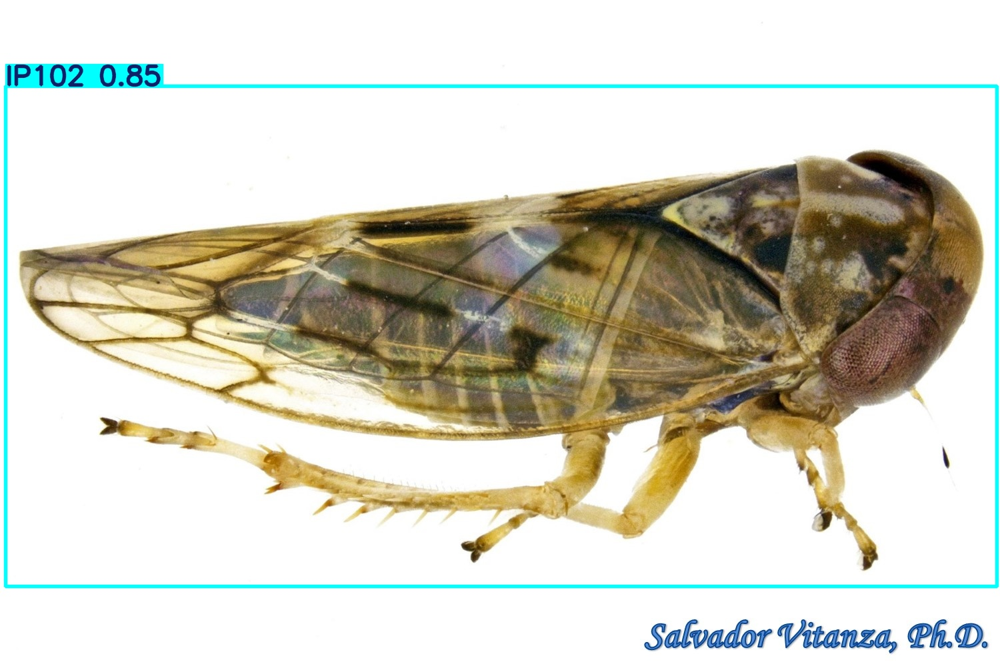
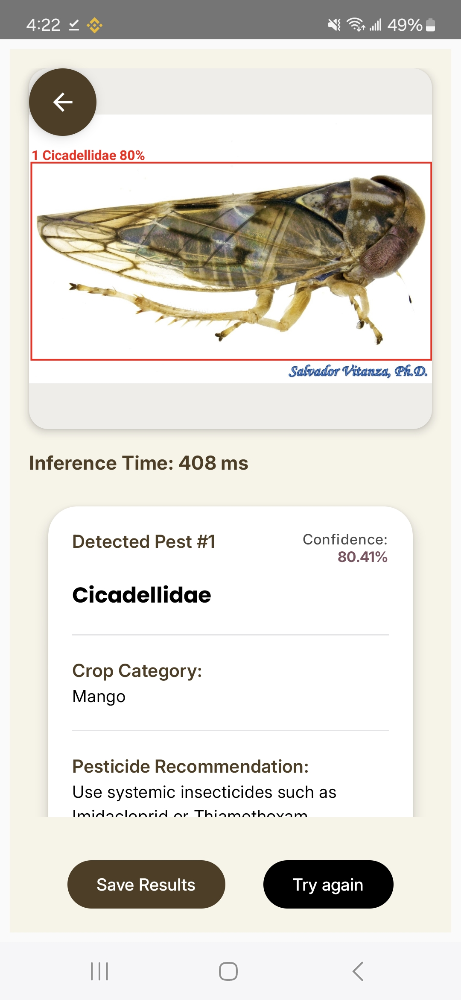
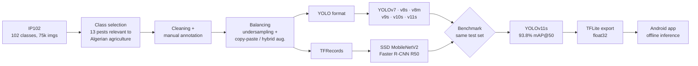
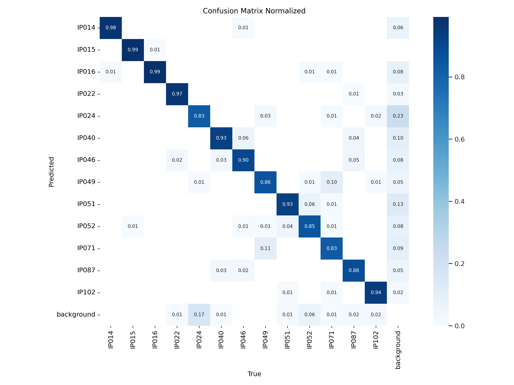
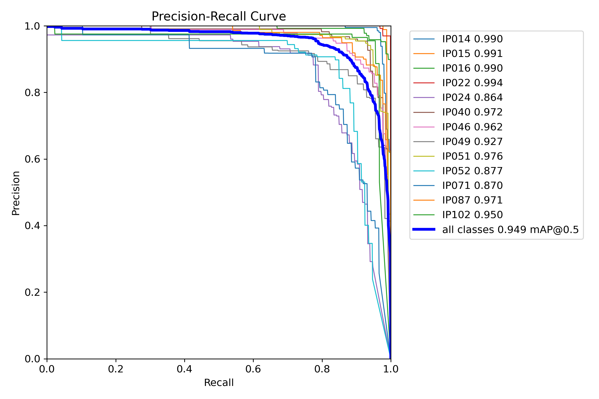
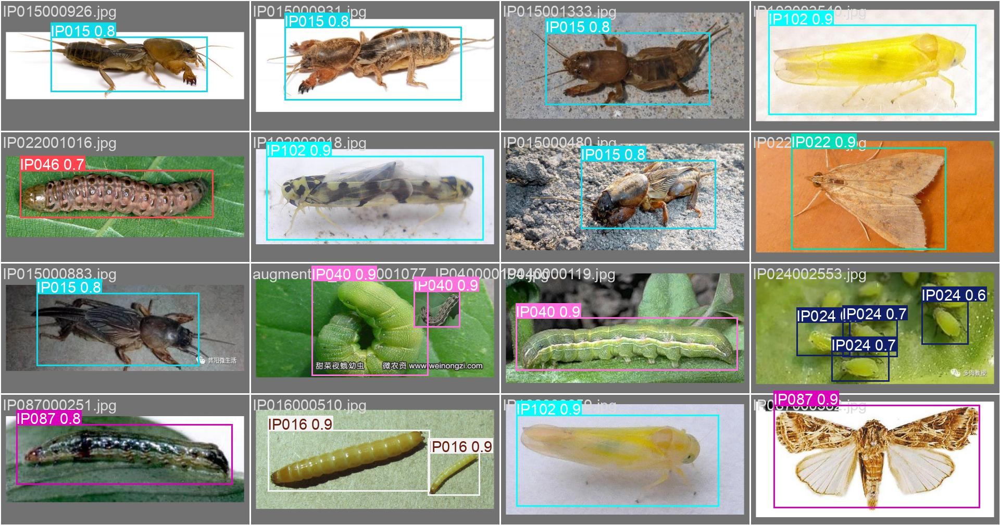

# Agricultural Pest Detection · Computer Vision Research


-blue)

**Dataset curation → model benchmarking → quantization → on-device deployment.**

This is the AI research half of an end-to-end system that helps farmers identify crop pests **offline**, straight from their phone. I benchmarked 8 object detection architectures on a curated subset of IP102 and picked **YOLOv11s (93.8% mAP@50, 9.4M params)** as the best accuracy/latency trade-off. It was then exported to TensorFlow Lite and runs in real time inside a native Android app.

> Part of the [Mobile Agricultural Pest Detection System](https://github.com/MehdiBedja/pest-detection-system):
> **AI research** · [Android app](https://github.com/MehdiBedja/pest-detection-android) · [Backend API](https://github.com/MehdiBedja/pest-detection-api)

<p align="center">
  
  
</p>

## Pipeline



## Benchmark

All models were evaluated on the same held-out test set: **1,089 images, 1,618 instances, 13 classes** (about 10,400 training images balanced to ~800 per class).

| Model | Params | GFLOPs | Precision | Recall | mAP@50 | mAP@50-95 |
| --- | ---: | ---: | ---: | ---: | ---: | ---: |
| YOLOv8m | 25.8M | 78.7 | 0.892 | 0.905 | **0.940** | **0.723** |
| **YOLOv11s (selected)** | **9.4M** | **21.3** | 0.885 | 0.888 | 0.938 | 0.716 |
| YOLOv9s | 7.1M | 26.8 | 0.899 | 0.888 | 0.938 | 0.715 |
| Faster R-CNN ResNet50 | n/a | n/a | ~0.936 | 0.740 | 0.936 | 0.646 |
| YOLOv10s | 8.0M | 24.5 | 0.901 | 0.883 | 0.934 | 0.716 |
| YOLOv8s | 11.1M | 28.5 | 0.880 | 0.908 | 0.933 | 0.712 |
| SSD MobileNetV2 640 | n/a | n/a | ~0.72 | 0.718 | 0.886 | 0.583 |
| YOLOv7 | ~36M | ~104 | 0.655 | 0.667 | 0.684 | 0.415 |

**Why YOLOv11s and not YOLOv8m?** It comes within 0.2 pt of YOLOv8m's mAP@50 with **2.7× fewer parameters and 3.7× fewer FLOPs**, which is what matters on a mid-range phone with no network. Full numbers are in [`results/ResultsSummary.txt`](results/ResultsSummary.txt).

### YOLOv11s results

<p align="center">
  
  
</p>
<p align="center">
  
  
</p>

## Dataset engineering

Starting from **IP102**, the largest public pest benchmark:

1. **Class selection.** I got the crop-pest mapping from the IP102 authors and kept pests that affect wheat and other Algerian crops, checked against agricultural literature.
2. **Annotation.** About 100 annotated images per class wasn't enough, so I manually annotated ~300 more and filtered out low-quality classification images.
3. **Final 13 classes:** grub, wireworm, corn borer, beet armyworm, flax budworm, legume blister beetle, *Prodenia litura*, mole cricket, aphids, *Lytta polita*, blister beetle, Miridae, Cicadellidae.
4. **Balancing.** I undersampled the dominant classes and used copy-paste plus hybrid augmentation for rare ones, reaching ~800 images per class.
5. **Format conversion.** XML → CSV → TFRecords (TF Object Detection API) and YOLO txt.

Details are in [`preprocessing/README.txt`](preprocessing/README.txt), and the Kaggle dataset links are in [`data/README.txt`](data/README.txt).

## Run inference

```bash
git clone https://github.com/MehdiBedja/pest-detection-computer-vision.git
cd pest-detection-computer-vision
pip install -r requirements.txt
cd deployment
python detect.py          # runs yolov11s.pt on testImage.jpg → testImageResult.jpg
```

`deployment/yolov11s_float32.tflite` is the exact model shipped in the Android app.

## Repository structure

```
├── data/                 # dataset descriptions + Kaggle links
├── preprocessing/        # selection, balancing, augmentation, format conversion scripts
├── training_notebooks/   # YOLOv8/9/10/11, SSD, Faster R-CNN training (Kaggle GPU)
├── results/              # metrics, curves, confusion matrices, sample predictions per model
└── deployment/           # detect.py, yolov11s.pt, yolov11s_float32.tflite, sample images
```

## Tech

PyTorch · Ultralytics · TensorFlow / TF Object Detection API · TensorFlow Lite · OpenCV · Albumentations · Kaggle GPUs

## Author

**Mahdi Bedja**, AI Engineer · [Portfolio](https://mehdibedja.github.io) · [LinkedIn](https://www.linkedin.com/in/mahdi-bedja-0b94031b3/)
